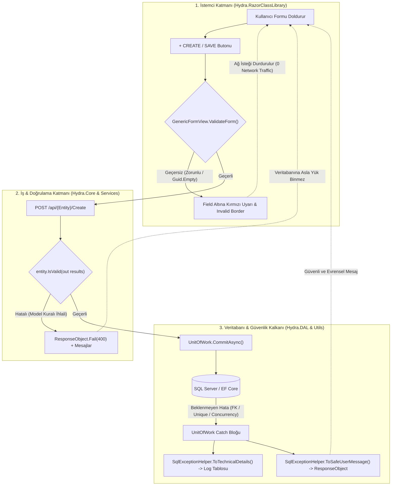

# 2.5 — Uçtan Uca Validasyon ve Güvenli Hata Yönetimi: Çok Katmanlı Doğrulama, CWE-209 Güvenlik Kalkanı ve Blazor Form Motoru

Bu doküman, Hydra ekosisteminde kullanıcıdan veritabanına ve veritabanından kullanıcıya uzanan **Doğrulama (Validation)** ve **Hata Yönetimi (Secure Error Handling)** mimarisini belgeler.

Sistem iki temel tasarım felsefesi üzerine kurulmuştur:
1. **Defense-in-Depth (Çok Katmanlı Savunma):** Doğrulama hem istemcide (Blazor form motoru) hem de sunucuda (Entity iş kuralları) aynı C# modelleri üzerinden sıfır kod tekrarıyla (DRY) işletilir.
2. **Security by Design (CWE-209 Bilgi İfşasını Engelleme):** Geliştirici logları (teknik stacktrace, SQL constraint adı, tablo isimleri) ile son kullanıcıya dönen API yanıtı (insan okunaklı, güvenli, veritabanı şemasını gizleyen evrensel mesajlar) kesin çizgilerle birbirinden ayrılmıştır.

---

## Büyük Resim: Validasyon ve Hata Kalkanı Akışı



---

## 1. Güvenlik Kalkanı: Developer Log vs. User-Facing Response

Birçok sistemde veritabanından dönen SQL hataları doğrudan son kullanıcıya yansıtılır. Örneğin:
`The INSERT statement conflicted with the FOREIGN KEY constraint "FK_Employee_Position_PositionId". Table "dbo.Position", column 'Id'.`

Bu durum saldırganlara veritabanı şemasını, tablo ve sütun isimlerini açık eden ciddi bir güvenlik zafiyetidir (**OWASP / CWE-209: Information Exposure Through an Error Message**).

Hydra, [`Hydra/Utils/SqlExceptionHelper.cs`](file:///C:/Users/ararg/source/AIRepos/Hydra/Utils/SqlExceptionHelper.cs) üzerinden bu iki dünyayı birbirinden ayırır:

### A. Geliştirici İçin (`ToTechnicalDetails`):
Hatanın tüm teknik ayrıntıları, tablo adı, sütun adı, constraint adı ve ham istisna metni doğrudan `TentacleLogDatabase` veritabanındaki `Log` tablosuna yazılır:
```csharp
[SQL ForeignKey Violation] Constraint: 'FK_Employee_Position_PositionId', Table: 'dbo.Position', Column: 'Id'.
```

### B. Kullanıcı İçin (`ToSafeUserMessage`):
İç mimariye dair hiçbir ipucu verilmez; insan okunaklı ve evrensel bir dille yanıt dönülür:
- **Foreign Key Hatası (Ekleme / Güncelleme):** `"A selected related record does not exist or has been removed."`
- **Foreign Key Hatası (Silme):** `"This record cannot be deleted because it is currently referenced by other records."`
- **Benzersizlik (Unique / Primary Key) Hatası:** `"A record with this information already exists."`
- **Kilitlenme (Deadlock / Timeout):** `"The system is currently busy. Please try again in a few moments."`

---

## 2. Entity Seviyesinde Basit ve Generic Validasyon

Hydra mimarisinde her entity sınıfı, karmaşık doğrulama altyapıları kurmak zorunda kalmadan yalnızca `Validate` metodunu override eder. Kurallar `nameof` kullanılarak derleme zamanı garantisiyle bildirilir.

### A. `ValidationManager` Şablonları (`Hydra/ValidationManagement/`):
```csharp
// Zorunlu alan kontrolü
ValidationManager.Required(nameof(Name), "Full Name");

// Seçim zorunluluğu (Dropdown / Guid / Foreign Key)
ValidationManager.MustBeSelected(nameof(PositionId), "Position");
```

### B. Entity Örneği: `Employee.cs`:
```csharp
public class Employee : BaseObject<Employee>
{
    public Guid PositionId { get; set; }
    
    [ForeignKey("PositionId")]
    public Position? Position { get; set; }

    public override IEnumerable<ValidationResult> Validate(ValidationContext validationContext)
    {
        foreach (var result in base.Validate(validationContext))
            yield return result;

        if (string.IsNullOrWhiteSpace(Name))
            yield return ValidationManager.Required(nameof(Name), "Full Name");

        if (PositionId == Guid.Empty)
            yield return ValidationManager.MustBeSelected(nameof(PositionId), "Position");
    }
}
```

### C. Localization (Çoklu Dil) Hazırlığı
`ValidationManager.Localizer` delegesi sayesinde sistem çoklu dile hazırdır. İleride sistem dili Türkçe veya başka bir dile geçtiğinde hiçbir entity kodunu değiştirmeden, yalnızca localization hook'u üzerinden mesajlar yerelleştirilir:
```csharp
ValidationManager.Localizer = (key, args) => stringLocalizer[key, args];
```

---

## 3. Frontend Blazor Form Motoru (`Hydra.RazorClassLibrary`)

Tüm CRUD formları (`GenericFormView.razor`), tek bir merkezden akıllı form doğrulama yeteneğine sahiptir:

1. **DRY İlkesiyle Çift Yönlü Doğrulama:** Blazor C# ortamında çalıştığı için, `Model is IValidatableObject validatable` kontrolü ile sunucudaki doğrulama kuralları (`Employee.Validate()`) istemci tarafında da birebir işletilir.
2. **Kullanıcı Deneyimi (UX):** Kullanıcı boş form ile "Create" veya "Save" butonuna bastığında:
   - Ağ isteği (HTTP request) engellenir.
   - İlgili input/select kutusunun kenarlığı kırmızı yanar (`hydra-form__field--invalid`).
   - Kutunun hemen altında hata mesajı belirir (`<span class="hydra-form__field-error">Position must be selected.</span>`).
   - Kullanıcı alana geçerli bir değer girdiği veya seçim yaptığı anda hata uyarısı anında kaybolur.
3. **Savunma Derinliği:** Kullanıcı tarayıcıda formu atlatsa veya API'ye doğrudan istek atılsa bile sunucudaki `entity.IsValid()` kalkanı devreye girer ve veritabanı gereksiz yere meşgul edilmez.

---

## İlgili Dosya Referansları

| Katman | Dosya Yolu | Sorumluluk |
|---|---|---|
| **Security Shield** | `Hydra/Utils/SqlExceptionHelper.cs` | SQL hatalarını güvenli kullanıcı mesajı ile teknik loga ayırma |
| **Transaction & Log** | `Hydra/DAL/Core/UnitOfWork.cs` | Commit işlemi, teknik loglama ve `LastErrorSafeMessage` aktarımı |
| **Service Validation** | `Hydra/Services/Core/Service.Command.cs` | `entity.IsValid` kontrolü ve güvenli hata dönüşü |
| **Validation Rules** | `Hydra/ValidationManagement/ValidationManager.cs` | Evrensel doğrulama şablonları & Localization hook'u |
| **Core Base** | `Hydra/Core/BaseObject.cs` | `IValidatableObject` sözleşmesi |
| **Entity Implementation** | `Hydra/Core/HumanResources/Employee.cs` | Örnek entity validasyon kuralları |
| **Frontend Form Engine** | `Hydra.RazorClassLibrary/.../GenericFormView.razor` | İstemci tarafı doğrulama & field-error görselleştirmesi |
| **Styling** | `Hydra.RazorClassLibrary/.../hydra-default.css` | `.hydra-form__field--invalid` ve `.hydra-form__field-error` stilleri |
