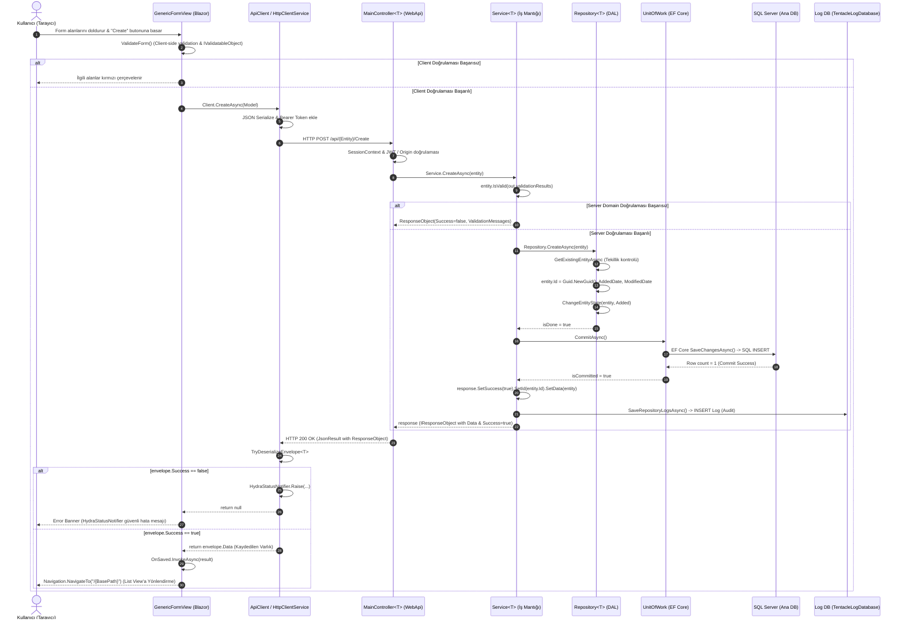

# Bölüm 2.6 — Create Story: UI'dan Veritabanına Bir Kaydın Uçtan Uca Hikayesi

Bu doküman, Hydra ekosisteminde bir varlığın oluşturulması (`Create`) sürecinin Blazor UI katmanından başlayıp SQL Server veritabanına ve oradan geri bildirim olarak arayüze dönüşüne kadar olan tüm yaşam döngüsünü teknik detaylarıyla ele alır.

---

## 1. Yaşam Döngüsü Özeti (Sequence Diagram)

---

## 2. Mimari Katmanlar ve Sorumluluklar

| Katman | Dosya / Bileşen | Sorumluluk |
|---|---|---|
| **Arayüz (UI)** | `GenericFormView.razor` | Form meta-verisini render etme, istemci doğrulama, dinamik girdi bağlama ve yönlendirme. |
| **HTTP Taşıma** | `ApiClient<T>.cs` & `HttpClientService.cs` | JWT taşıma, `ResponseObject` zarfını açma, `HydraStatusNotifier` üzerinden hata yayınlama. |
| **REST API** | `MainController<T>.cs` | Model binding, HTTP durum kodları ile envelope durumunu eşleme, route koruması. |
| **İş Mantığı** | `Service<T>.Command.cs` | Domain kuralları (`IsValid`), UoW koordinasyonu, response payload (`SetData`) paketleme. |
| **Veri Erişim** | `Repository<T>.Command.cs` | DB tekillik kontrolü (`GetExistingEntityAsync`), Id ve Audit tarihlerinin atanması, ChangeTracker. |
| **Birim İş & SQL** | `UnitOfWork.cs` & `SqlExceptionHelper.cs` | `SaveChangesAsync()`, SQL hata kodlarının CWE-209 uyumlu güvenli mesajlara çevrilmesi. |
| **Denetim İzi** | `LogFactory.cs` & `LogService.cs` | Başarılı oluşturma veya teknik hataların izole log veritabanına kaydedilmesi. |

---

## 3. Sahte Hata (False Failure) Post-Mortem

Bir Create işlemi sırasında veritabanında işlem başarıyla commit edildiği halde arayüzde *"Save failed. Please check the required fields."* uyarısının çıkması şu iki eksiklikten kaynaklanmıştı:
1. `Service.Command.cs`: Başarılı oluşturma sonrasında `response.SetData(entity)` çağrılmadığı için JSON zarfı `data: null` dönüyordu.
2. `GenericFormView.razor`: `result == null` durumunu mutlak hata kabul edip sabit metin gösteriyordu.

**Çözüm:** `Service.Command.cs` içine `response.SetId(entity.Id).SetData(entity)` eklendi; `GenericFormView.razor` ise `HydraStatusNotifier` ile entegre edilerek sunucudan gelen gerçek hata mesajlarını (örneğin SQL mükerrer kayıt, validasyon vb.) gösterecek şekilde güçlendirildi.
